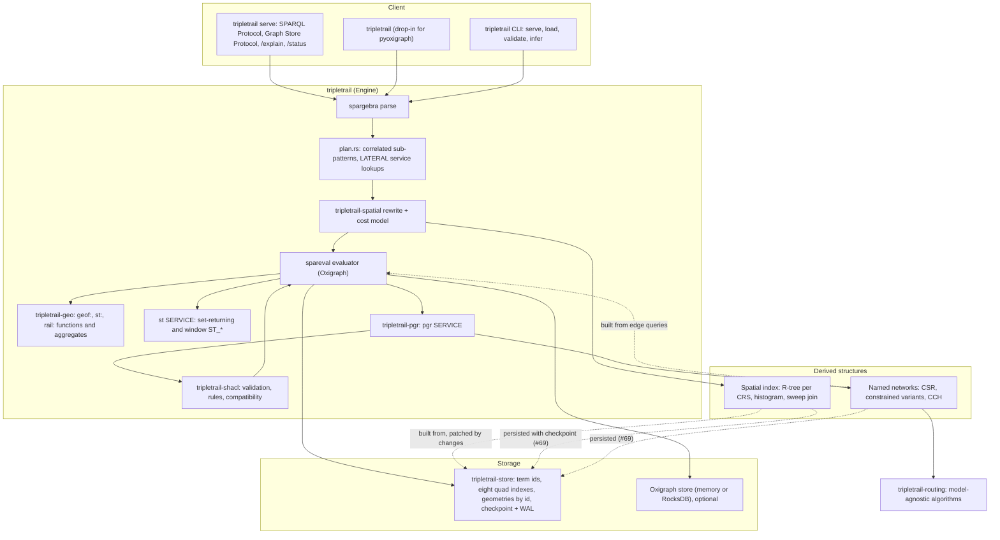

# Architecture: target state

This is the architecture from the plan (`plan/02-architecture.md` of 2026-10-20, which is not
in this repository), rewritten for
the state of TripleTrail once every open issue is fixed. Its marks were refreshed on 2026-11-07,
after the #76-#101 work and the review fixes (#129-#131, #134) merged: the issues #53-#72 are
closed (✅), except the tracker #62. On 2026-11-13 the marks of the follow-ups #104-#106,
#110, #121 and the tracker #62, all closed since, were set to ✅. Where one closed with a gap, the follow-up issue is named
instead (#102-#110 for performance, #111-#128 from the review of 2026-11-07). The
function-level view is in [function-matrix.md](function-matrix.md); the measurements behind the
performance work are in [the benchmark repository](https://github.com/Matdata-eu/tripletrail-bench).

Marks, as in the matrix: ✅ done on `main`, 📋 planned in an open issue, ⬜ in the plan but
neither built nor covered by an issue.

The plan's working name *railgraph* became **TripleTrail**; its `rg-*` crates are the `tripletrail-*`
crates below.

---

## 0. Decisions at a glance

| # | Plan decision | As built | Target state |
|---|---|---|---|
| D1 | Reuse `oxrdf`, `oxrdfio`, `spargebra`, `sparopt`, `spareval`, `sparesults`; own everything below the algebra. | ✅ Through the `oxigraph` crate, its evaluator hooks (custom functions, custom aggregates, `SERVICE` handlers) and `spareval::QueryableDataset`. No fork (`docs/phase-0.md`). | Unchanged. |
| D2 | Own storage: 64-bit term ids, sorted quad indexes, geometry side-store keyed by term id. | ✅ `tripletrail-store`, the default store since #30. Oxigraph's store stays selectable. | Writes stay cheap after many earlier writes (✅ #53); value-ordered index for numeric literals (✅ #71), patched by writes (✅ #212). |
| D3 | Geometries parsed once at load into a compact binary with a metadata header; points inlined into the term id. | Partly. Geometry literals have their own term kind and are parsed **lazily**, on first use, then kept by term id as `Arc<Geom>` (#32). No own binary encoding, no inline points. | The parsed geometry reaches the functions directly, never re-parsed through the text-keyed cache (✅ #73 for the spatial tests, ✅ #70 for every function). Metric length/area kept with the index entries (✅ #70). Inline points and an own encoding ⬜. |
| D4 | Packed static Hilbert R-tree per segment + `rstar` delta, plus H3 cell lists as a join prefilter. | An `rstar` R-tree per CRS, patched in place on writes, with a grid histogram for estimates, and a parallel sweep-line join. | Covers every geometry literal on any predicate (✅ #74); built in the background at start (✅ #69), persisted with the store checkpoint and loaded at open (✅ #105). Prepared polygons with a banded edge index replace the cell-list idea for exact tests (✅ #73). Packed Hilbert trees and H3 cell lists ⬜. |
| D5 | Pre-planner on the algebra; spatial joins, KNN, routing as own physical operators bridged into `spareval`. | A rewrite on the `spargebra` algebra that turns spatial FILTERs into `VALUES` blocks of candidates (and `LATERAL` pins), chosen by a cost model; `EXISTS` sub-patterns planned from bound variables. Routing and set-returning functions are `SERVICE` handlers. | Exact candidate blocks drop the FILTER (✅ #73); `SERVICE` rows joined to their triples laterally (✅ #75); planning cancellable (✅ #75); more correlated shapes planned as `LATERAL` (✅ #57). Spatial joins and geometry aggregates over plain patterns run on term ids in the store, their result read by the evaluator from an id table through virtual triples (✅ #127); merge joins over sorted permutations (✅ #167, #168). |
| D6 | Routing core is data-model agnostic: pgRouting edge sets from a SPARQL sub-select or a named network; profiles are data. | ✅ As planned, including CCH (`pgr:engine "ch"`), constraints on `?c_*` columns, SHACL compatibility filters and four profiles. | Component labelling cached, parallel and bucket-based cost matrices (✅ #72); networks and hierarchies persisted by the server (✅ #69). |
| D7 | Linear referencing as a subsystem with stored measure tables per net element. | Changed: `rail:` LR functions are model-agnostic and work on the line and kilometre table the query passes (a string of anchors or an M line). No stored measure tables. | Range scans on asserted kilometre values (✅ #71). Stored measure tables ⬜ (not needed so far). |
| D8 | Networks and the spatial index are derived structures, invalidated or patched from the change log. | ✅ Writes with known changes keep networks that don't read changed predicates and patch the index; other writes drop them. | Bulk loads keep the index too (✅ #69). |
| D9 | Store geometry in its source CRS plus a CRS84 copy for one global index. | Changed: one R-tree per CRS, no CRS84 copy. Geographic metric operations are geodesic or use a local projection. | Point × geometry distance on the ellipsoid, within 2 mm of Karney (✅ #73). |
| D10 | *(new)* GEOS, PROJ and SFCGAL planned as FFI dependencies. | Decided otherwise: everything is pure Rust (`geo` plus own code), including overlay, buffer, validity, 3-D and SFCGAL-like functions. Transforms cover the CRSs listed in the matrix, without PROJ's database. | 7-parameter datum shifts for national CRSs via `proj4rs` (#740); grid-based transformations stay out. |
| D11 | *(new)* SHACL inside the engine. | `tripletrail-shacl`: Core, SPARQL, AF targets and rules, compiled once and checked by direct lookups; used by routing filters. | Validation reports with severities, Python and CLI entry points (✅ #59, #61), rules evaluated per focus node (✅ #61). |
| D12 | *(new)* Drop-in for existing tools. | `tripletrail serve` with Fuseki's URL layout; tripletrail returning pyoxigraph terms; Jena `spatialf:` functions. | tripletrail as a drop-in for `pyoxigraph.Store`, including as an rdflib store (✅ #55), at pyoxigraph's speed (✅ #54). |

---

## 1. Component overview

| Crate | Responsibility | Target-state changes |
|---|---|---|
| `tripletrail-store` | Term dictionary with 64-bit ids, eight compressed sorted quad indexes plus a write delta, geometries parsed lazily and kept by id, snapshots for the evaluator, checkpoint and WAL on disk. | Indexed delta or compaction so writes stay O(log n) (✅ #53); value-ordered numeric object index (✅ #71, patched by writes #212); spatial index stored in the checkpoint (✅ #105); checksummed checkpoint files (✅). |
| `tripletrail-geo` | Every `geof:`, `st:` and `rail:` scalar function and aggregate; formats; CRS transforms; DE-9IM. | Fast relation paths, prepared polygons, mixed-dimension overlay, ellipsoidal distances (✅ #73); functions take the store's parsed geometry, cheaper geodesic length (✅ #70). |
| `tripletrail-spatial` | R-tree index, histogram, sweep-line join, query rewrite and cost model. | Any predicate, configurable (✅ #74); exact tests on parsed geometries in parallel, FILTER dropped when exact (✅ #73); cancellable (✅ #75); persisted (✅ #69). |
| `tripletrail-routing` | Model-agnostic algorithms on CSR graphs: shortest paths, CH/CCH, KSP, TRSP, flows, MST, orderings, TSP, VRP, time-dependent, Pareto. | Cached component labels, parallel and bucket many-to-many (✅ #72). |
| `tripletrail-pgr` | The `pgr` SERVICE: requests, edge sets from sub-selects or named networks, constraints, SHACL shapes, result tables. | Aggregated components output (✅ #72); networks reloaded at open (✅ #69). |
| `tripletrail-shacl` | SHACL Core and SPARQL validator, SHACL-AF rules (`Inference`), `compat:` rules compiled to shapes. | Report writer with severities (✅ #59); skip-unsupported option (✅ #58); per-focus rule evaluation (✅ #61). |
| `tripletrail` | `Engine`: a store with everything registered; `plan.rs` (correlated sub-patterns); `st_service.rs`. | Lateral service lookups and cancellable planning (✅ #75); more correlated shapes (✅ #57); `validate`/`infer` entry points (✅ #59, #61). |
| `tripletrail-server` | `tripletrail serve` and `tripletrail load`. | 503 at the deadline during planning (✅ #75); index predicate options (✅ #74); ready state on `/status`, background index build (✅ #69); `validate` and `infer` commands (✅ #59, #61). |
| `python/` (tripletrail) | PyO3 binding of `Engine`, with pyoxigraph's classes vendored. | pyoxigraph-compatible API (✅ #55), native term classes (✅ #54, #108), `validate`/`infer` (✅ #59, #61). |
| [tripletrail-bench](https://github.com/Matdata-eu/tripletrail-bench) | Synthetic and RINF benchmarks; the harness runs against PostGIS, GraphDB, Jena, QLever. | Re-run after each step of #62. |

---

## 2. Storage

### 2.1 Term ids and dictionary ✅
- Term id = `u64`. The low 4 bits are the kind (IRI, blank node, string, language string,
  typed literal, geometry literal, integer, boolean); the other 60 bits are a dense dictionary
  ordinal, or the value itself for canonical `xsd:integer` (±2^58) and `xsd:boolean`.
- Literals keep their lexical form (`"+7"` stays `"+7"`). The Python binding will return
  canonical `xsd:decimal` values as Oxigraph does, or document the difference (✅ #55).
- The dictionary is one byte arena with an end-offset array and a hash table of ordinals.
- Plan items not built ⬜: inline doubles, dates and geographic points in the id.

### 2.2 Quad indexes
- ✅ Eight permutations (SPOG, POSG, OSPG, GSPO, GPOS, GOSP, and PSOG / GPSO for predicate scans
  sorted by subject, #168), each an immutable segment of sorted
  quads in blocks of 16, delta-varint encoded, plus a sorted write delta folded into new
  segments at 65,536 quads.
- ✅ Exact counts for a pattern from the block index (two end blocks read), used by the cost
  model.
- ✅ #53: today a lookup or remove scans more of the delta after every remove, so N removes cost
  O(N²) (80 k removes: 262 s vs 2 s on Oxigraph's store). Target: the delta is indexed (or
  compacted early), so writes cost the same after 100 k earlier ones.
- ✅ #71: an object index for numeric literals ordered by **value**, so
  `FILTER(?km >= a && ?km <= b)` on `?lr era:kilometer ?km` is a range scan intersected with the
  other patterns, started from the smaller side by the store's counts. Target: a few ms for the
  "assets between km a and b" query (50 ms today; PostgreSQL 0.2 ms with a btree).
- ⬜ Memory-mapped columnar segments with zstd blocks (the plan's LSM layout): segments live in
  memory and are written whole to the checkpoint.

### 2.3 Geometries
- ✅ Geometry literals (`wktLiteral`, `geoJSONLiteral`, `gmlLiteral`, `kmlLiteral`, H3 cell
  lists) have their own term kind; they are parsed on first use and kept by id
  (`Snapshot::geometry(id)`).
- ✅ #74: `Dataset::geometry_literals` lists them from the quad ids, which is how the index finds
  every geometry whatever its predicate.
- ✅ #70: functions receive the stored `Arc<Geom>` for a store term (through the existing
  `Dataset::geometry` hook) instead of looking the literal text up in the parse cache. Until
  then the parse cache is sharded 64 ways with a sampled hash for long literals (✅ #73).
- ⬜ The plan's own binary encoding with a precomputed header, and per-geometry segment trees
  for huge polygons. #73's per-polygon banded edge index covers the second need at query time.

### 2.4 Transactions, change sets, persistence ✅
- One writer, snapshot readers; `transaction_with_changes` and `update` return the added and
  removed quads, which drive the derived structures (§4.3, §6.6).
- On disk: a numbered checkpoint (dictionary plus segments) and an N-Quads write-ahead log,
  synced per commit (group commit: queued commits share one sync, #709), folded into a new checkpoint at 256 MB; bulk loads write a checkpoint.
- ✅ #105: the checkpoint also holds the spatial index (the ordered `(envelope, term id)` list,
  from which `RTree::bulk_load` rebuilds in well under a second), versioned with the checkpoint
  number; named networks and hierarchies are saved next to it by the server.

---

## 3. CRS ✅
- Geographic: CRS84 and EPSG:4326 (authority axis order honoured on input, lon/lat inside).
- Transforms without PROJ: EPSG:3857, UTM (326zz, 327zz, ETRS89 258zz), 3006, 3035, 4258 computed in TripleTrail, and 65 national CRSs through `proj4rs` with 7-parameter datum shifts, and the projected CRSs `crs-definitions` (CC0) has, through `proj4rs`;
  PROJ pipeline strings for these projections. Agrees with PROJ within 1 cm.
- Metric operations on geographic data: point × point and lengths geodesic (Karney); point ×
  geometry on a tangent plane at the point, Karney beyond 50 m (✅ #73, fixing the 0.3 %
  spherical shortfall of the old local projection); buffers through a local projection.
- ✅ #70: a cheaper spheroid length for short segments (Karney kept where precision demands).
- Changed from the plan (D9): no CRS84 copy of projected geometries; each CRS has its own tree,
  and mixing CRSs in one function is an error, as in the functions.

---

## 4. Spatial indexing

### 4.1 Structures
- ✅ One `rstar` R-tree per CRS over geometry envelopes, bulk-loaded, patched in place for writes
  with known changes.
- ✅ A 64 × 64 grid histogram per tree for candidate estimates.
- ✅ #74: the index holds every distinct geometry literal on any predicate. `IndexedPredicates
  { only, except }` (`Engine::set_indexed_predicates`, `--index-predicate`,
  `--no-index-predicate`) narrows it; the default is everything.
- ✅ #73: a prepared structure per distinct polygon (banded edge index for point-in-polygon and
  segment crossings), built once per join.
- ✅ #70: index entries carry the metric length/area of their geometry, computed at build time.
- ⬜ Packed Hilbert R-trees per segment, KD-tree for points, H3 cell lists.

### 4.2 Access paths

| Pattern | Operator | Target-state change |
|---|---|---|
| `FILTER(geof:sfX(?w, C))`, `st:` equivalents | Candidates from the envelope of `C` as `VALUES ?w`, if the cost model says the block beats the FILTER | Tested in parallel on parsed geometries with fast paths; FILTER dropped when the block is exact (✅ #73) |
| `FILTER(distance(?w, C) < d)`, `ST_DWithin` | Envelope grown by `d` | Same (✅ #73) |
| `ORDER BY distance(?w, C) LIMIT k` | Growing radius over the index | Candidates pinned before the class triple; < 5 ms target (✅ #73; then ✅ #104, #121). Needs `geo:asWKT` (rows with an error distance must be kept) |
| Two variables, one side small | Index nested loop from the smaller side | Pairs tested once, in parallel (✅ #73) |
| Two variables, both large | Parallel sweep-line join over stripes | Pairs tested once on parsed geometries (✅ #73) |
| Two variables, plain sides, TripleTrail store | Sides joined on term ids, swept, result handed to the evaluator as an id table | No `VALUES` block, no pair cap (✅ #127) |
| One side bound only through `SERVICE`/`BIND` | Nested loop in the evaluator | `LATERAL` lookup per service row (✅ #75) |
| `?a geo:sfX ?b` | Query Rewrite to the FILTER forms above | Any predicate (✅ #74) |

### 4.3 Maintenance and start-up
- ✅ Writes with known changes patch the trees; other writes drop them, and the next spatial
  query rebuilds (9 s on 700 k geometries in benchmark v2).
- ✅ #69, #105: load the persisted index at open; otherwise build in the background at start, so the
  first query waits only for what is left; route bulk loads through the patching path or a
  background rebuild; `/status` reports "ready" so cold benchmarks measure the page cache.

---

## 5. Query engine

### 5.1 Pipeline (target state)
1. `spargebra` parses the query or update.
2. **`plan.rs`** (✅ for `EXISTS`/`NOT EXISTS`):
   - correlated sub-patterns ordered from their bound variables and chained with `LATERAL`;
   - ✅ #75: a join that contains a `SERVICE` (possibly under `BIND`s and `FILTER`s) starts from
     the service and looks up the connected triples once per service row, with `LATERAL`
     (blank nodes become variables; rows leaving the link unbound are dropped with
     `sameTerm(?k, ?k)`, since Oxigraph optimises `BOUND` away for service variables);
   - ✅ #57: the remaining correlated shapes from the rail KG UPDATEs: inner patterns after
     `BIND`/`OPTIONAL` planned with their bound variables, BIND-keyed joins as `LATERAL`,
     correlated `UNION`, `LATERAL` triples after `VALUES`.
3. **Spatial rewrite** (`tripletrail-spatial`, ✅): spatial FILTERs, relation triples and KNN
   become `VALUES` candidate blocks and pins, decided by the cost model (§5.2). It runs side
   queries (`values_of`) through the same planner (✅ #75) and checks the cancellation token
   between candidate tests (✅ #75).
4. Oxigraph's optimizer and evaluator run the result, calling the registered functions,
   aggregates and `SERVICE` handlers.
5. The engine returns `Cancelled` when the token fired during planning (✅ #75); the server
   answers 503 at the deadline.

### 5.2 Cost model ✅
Exact triple-pattern counts from the TripleTrail store's block index (Oxigraph's store: counted to
250 k), join estimates, and index candidate estimates from the histogram, drive four decisions:
inject a constant test or leave it to the FILTER; which side of a join probes; whether to pin a
candidate block with `LATERAL`; nested loop or sweep. `RewriteStats` and `/explain` record each
decision. Target-state additions: the narrow side of a join is evaluated too (✅ #73), and the
numeric range index gets estimates from the store's counts (✅ #71).

### 5.3 Function dispatch
- ✅ Functions are `with_custom_function` closures over `Term`s; aggregates are custom aggregates.
- ✅ #73: the spatial rewrite tests candidates with `geom_predicate` on the `Geom`s the index
  holds, not through the registered functions.
- ✅ #70: all functions get the stored geometry for a store term, skipping the text cache; large
  `SUM`/`COUNT` groups over plain BGPs are aggregated in parallel chunks.
- SPARQL error semantics: a function error makes the FILTER false or the BIND unbound.

### 5.4 Table-valued functions ✅
`SERVICE <http://w3id.org/tripletrail/pgr>` for routing and graph analysis, `SERVICE
<http://w3id.org/tripletrail/st>` for set-returning and window `ST_*`. Parameters are triples with a
constant object, result columns triples with a variable object, inputs nested sub-selects. The
plan's property-function sugar (`(?seq ?edge) pgr:pgr_dijkstra (…)`) was not built ⬜.

### 5.5 Batch precomputation ⬜
`rail:materializeRelations` (write `geo:sf*` triples for a whole graph) was not built and has no
issue; an `INSERT … WHERE { … FILTER(geof:sfX(…)) }` goes through the same sweep join.

---

## 6. Routing

### 6.0–6.2 Edge sets, named networks, profiles ✅
As in the plan: the core sees only pgRouting-shaped edge sets (`?id ?source ?target ?cost
[?reverse_cost] [?x1 ?y1 ?x2 ?y2] [?geom] [?c_*]`), restriction sets and points sets, from a
sub-select (cached by its algebra until the data changes) or a named network (`pgr:Network`
with `pgr:edgeQuery`). The plan's `CREATE NETWORK` Update syntax was replaced by the RDF
description ⬜. Profiles shipped: `era-micro`, `era-micro-reversing`, `era-sol`,
`generic-triples`, `rinf-compatibility.ttl`; RTM, OSM railway and OpenTNF ⬜.

### 6.3 Graph build ✅
Terms to dense `u32`, pgRouting cost rules, CSR (+ reverse), parallel UNION-branch build (#31).
Restrictions become an edge-based search graph. Constraints (`pgr:constraint` over `?c_*`) and
SHACL filters (`pgr:shapes`, `pgr:vehicle`) produce cached constrained variants (eight per
network).

### 6.4 Preprocessing ✅
CCH for `pgr:engine "ch"`: contracted once, customised per constraint set and re-customised on
cost-only writes.

### 6.5 Hierarchical routing ✅
`rail:routeHierarchical` / `rail:refine` on a coarse and a fine network plus a mapping.

### 6.6 Algorithms

| Need | As built | Target state |
|---|---|---|
| Point-to-point | Dijkstra, bidirectional Dijkstra, A*, CCH | Unchanged |
| Many-to-many, cost matrices | One-to-many Dijkstra per source, serial | Sources in parallel over the read-only network; bucket (PHAST-style) search on the CCH when it exists. Target 100 × 100 under 2 s on 750 k edges (✅ #72) |
| Driving distance | One-to-all with cutoff | Several sources in parallel (✅ #72) |
| Components | Union-find per call; one row per vertex through the SERVICE | Labelling cached per network (it changes only with the network); aggregated output (component sizes) when only aggregates are projected; integer vertex ids where the IRI isn't needed. Target under 500 ms on 688 k vertices (✅ #72) |
| KSP, TRSP, via, near, withPoints, flows, MST, orderings, TSP, VRP, time-dependent, Pareto | ✅ | Unchanged |

### 6.7 Maintenance and persistence
- ✅ Writes with known changes keep networks whose edge query reads none of the changed
  predicates; CCH is re-customised on cost-only changes.
- ✅ `Engine::with_network_dir` saves networks and hierarchies (restart 5.2 s → 0.5 s at
  230 k vertices).
- ✅ #69: the server uses it with the store location, so `tripletrail serve --location …` starts
  with its networks (the benchmark still paid 5–12 s at the first route).

### 6.8 Results ✅
pgRouting's columns verbatim, plus `geom`, `?c_*` columns, `rail:routeGeometry` and
`rail:routeAsList`. Node and edge values are the original terms, so results join back to the
data; in the target state that join is a lateral lookup per row (✅ #75): "route, then main
signals within 50 m" takes 0.82 s on the large set, against 17 s before and 1.16 s on PostGIS.

---

## 7. Linear referencing

- ✅ PostGIS LR functions on raw geometries (`ST_LineLocatePoint`, `ST_LineSubstring`,
  `ST_LocateAlong/Between`, `ST_InterpolatePoint`, `ST_AddMeasure`, …).
- ✅ `rail:locate`, `rail:intrinsicAt`, `rail:kmAt`, `rail:intrinsicAtKm`,
  `rail:geomBetweenKm`, `rail:offsetGeom`: model-agnostic, on a line (or ordered multi-line)
  and a kilometre table passed by the query (an anchor string or a line with M = km), with
  jumps and overlaps. Geodesic on CRS84/EPSG:4326, planar otherwise.
- Changed from the plan (D7): no stored per-element measure tables; the profile's query
  supplies line and table.
- ✅ #71: queries on asserted kilometre values (`era:kilometer`) use the value-ordered numeric
  index, so "assets between km a and b on line X" is a range scan.

---

## 8. SHACL (new)

- ✅ `Shapes::compile` reads a shapes graph once; `Validator` checks focus nodes by direct
  lookups on either store or an in-memory graph. Core is complete; SHACL-SPARQL constraints,
  components and SPARQL targets run on Oxigraph's evaluator with `$this` bound by `VALUES`
  (`prefetch`). On the rail KG (12.5 M triples, 786 shapes): validation in 20 s and 2.4 GB,
  against 69–74 s and 4.8 GB for maplib.
- ✅ `Inference` runs SHACL-AF rules (`sh:TripleRule`, `sh:SPARQLRule`, `sh:order`,
  `sh:condition`) to a fixpoint and returns the inferred triples. The rules are stratified
  by the predicates they write and read: groups that feed each other loop, other rules run
  once, and a later pass reruns only the rules whose inputs changed (#110). That rerun is
  semi-naive: a SPARQL rule's query is rewritten into variants, each with one triple pattern
  read from the triples inferred since the rule last ran (a `VALUES` block), and only new
  focus nodes run the whole query (`delta.rs`). Aggregates, `LIMIT`, `SERVICE`, paths or
  `EXISTS` reading new triples, and patterns matching more than 16k of them run in full.
  `tripletrail infer --naive` turns it off. Rules that read nothing the rules before them may
  write run together on several cores and their triples are merged in rule order, so each
  sees what it would see run one at a time (#891); a template triple that copies a triple
  the `WHERE` clause matches (also inside an `OPTIONAL`, when one of its variables is bound
  only there) is not counted as written.
- ✅ Routing uses it: `pgr:shapes`, and `compat:` vehicle rules compiled to shapes.
- ✅ #58: a compile option that skips unsupported constraints with a warning.
- ✅ #59: a report writer. One `sh:ValidationResult` per failure with focus node, path, value,
  source shape (the property shape), source constraint component, message (all languages) and
  severity; `sh:conforms`; `sh:Warning`/`sh:Info` no longer counted as violations; optional
  `sh:detail`. Streamed (about 1–2 M results on the rail KG), as a graph or as rows.
- ✅ #61: rules evaluated per focus node, with `$this` pre-bound or as a correlated join key
  planned by §5.1 (#57), so the 11 RINF rules that never finish in 600 s run in seconds;
  output into a named inference graph.
- ✅ #59, #61: `Engine.validate(...)` / `Engine.infer(...)` in Python and `tripletrail validate` /
  `tripletrail infer` on the CLI.

---

## 9. Interfaces

### 9.1 Server ✅
`tripletrail serve`: SPARQL 1.1 Protocol and Graph Store Protocol with Fuseki's URL layout, several
datasets, `/explain`, `--timeout` with 503, `/$/ping`, `/$/datasets`, CORS; `TCP_NODELAY` on the
socket (✅ #73). Target additions: the timeout covers planning (✅ #75), index predicate options
(✅ #74), a ready state and background index build at start (✅ #69), `validate`/`infer`
(✅ #59, #61). Since then the server has become a Fuseki replacement (admin API, aliases,
backups, access control with sparql-guard policies, a web UI with the Workbench and a Map page,
pipelines, describe pages, OGC API Features and vector tiles, the RDF4J REST API): see
[server.md](server.md).

### 9.2 Python ✅
tripletrail wraps `Engine` and has pyoxigraph's term, I/O and result classes itself (vendored
in `python/src/ox`), so it needs no pyoxigraph. Target (✅ #55): `bulk_load`,
`bulk_extend`, `query(…, default_graph=…, named_graphs=…, use_default_graph_as_union=…)`,
`QuerySolution.get`, `named_graphs()`/`add_graph()`/`remove_graph()`, an rdflib store
(`tripletrail.rdflib`); canonical decimals. Speed (✅ #54, #108): term objects built natively, so
`quads_for_pattern` runs at pyoxigraph's speed.

---

## 10. Performance targets

Benchmark v2, large synthetic RINF set (10.5 M triples, 4 vCPU), warm p50.

| Query | Before (#60) | With #73–#75 | Target (issue) | PostGIS |
|---|---:|---:|---:|---:|
| OPs × regions (`sfWithin` join) | 34 s | 0.78 s | < 1 s (#63) | 58 ms |
| OSM stations × admin / tracks × landuse | 22 s / 171 s | not re-run | 2–3× PostGIS (#63) | 229 ms / 898 ms |
| Signals × elements ≤ 20 m | 6.9 s | 5.7 s | ~2 s (#67) | 1.07 s |
| Route, then signals within 50 m | 17 s | 0.82 s | near route time (#64) | 1.16 s |
| Track length per region | 40 s, no values | 5.5 s, correct | (#65, #63) | 5.2 s |
| Box / polygon selection | 66 / 64 ms | 2–3 ms | < 5 ms (#68) | 0.4 / 0.2 ms |
| KNN 10 OPs | 23 ms | 11 ms | < 5 ms (#68) | 0.6 ms |
| Assets between km a and b | 50 ms | | a few ms (#71) | 0.2 ms |
| Total track length | 1.61 s | 0.92 s | ~300 ms (#70) | 331 ms |
| First spatial query after start | 8.9 s | | load at open (#69) | ~0 |
| Geographica 2 joins | 19–249 s, 5 timeouts | not re-run | seconds (#66, #63) | QLever 0.1–9 s |
| Connected components | 2.1 s | | < 500 ms (#72) | 1.37 s |
| 100 × 100 cost matrix | 10 s | | < 2 s (#72) | 22 s |

Outside benchmark v2, from the rail KG evaluation: spatial UPDATEs back to seconds and cancellable
(✅ #75, #56); the 12 correlated UPDATEs that time out run in Jena's range (✅ #57); 80 k removes
in about Oxigraph's 2 s (✅ #53).

---

## 11. Open questions from the plan

| Id | Question | Status |
|---|---|---|
| OQ-1 | Name, namespaces, licence | Name TripleTrail; namespaces `http://w3id.org/tripletrail/{st,pgr,rail,compat}#`. Licence: Apache 2.0, open core. |
| OQ-2 | Rust, extension on Oxigraph crates, own storage | Confirmed and built. |
| OQ-3 | Rail data modelling | Answered by the rail KG evaluation (#15–#23, #53–#61). |
| OQ-4 | GEOS as a default dependency | Decided: pure Rust, no GEOS/PROJ (D10). |
| OQ-5 | Canonical vs verbatim `asWKT` | Verbatim: literals keep their lexical form. Decimals in Python: #55. |
| OQ-7 | Virtual properties | Asserted wins, else computed. |
| OQ-8 | Bulk reload vs continuous updates | Both supported; write cost after many writes is #53. |
| OQ-10 | pgRouting result columns verbatim | Yes, extras opt-in. |
| OQ-11 | Map serving in v1 | `ST_AsMVT`/`ST_AsMVTGeom`, a vector tile endpoint, OGC API Features and a Map page in the web UI. |
| OQ-12 | Reasoning beyond GeoSPARQL | SHACL validation and SHACL-AF rules (§8); RDFS and OWL 2 RL materialised into a graph and kept up to date with every write, with the OWL 2 RL consistency checks (✅ #187). Query-time reasoning ⬜. |
| OQ-14 | Benchmark systems | PostGIS/pgRouting, GraphDB, Jena, QLever (benchmark v2). |
| OQ-15 | Profiles in v1 | ERA micro, ERA sections of line, generic `pgr:` triples, RINF compatibility. |
| OQ-6, OQ-9, OQ-13 | Hardware, cost dimensions, upstreaming | No change recorded. |
